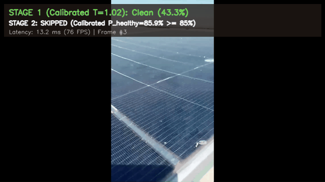
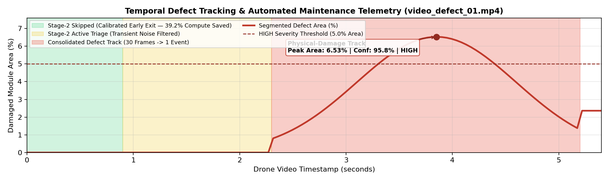
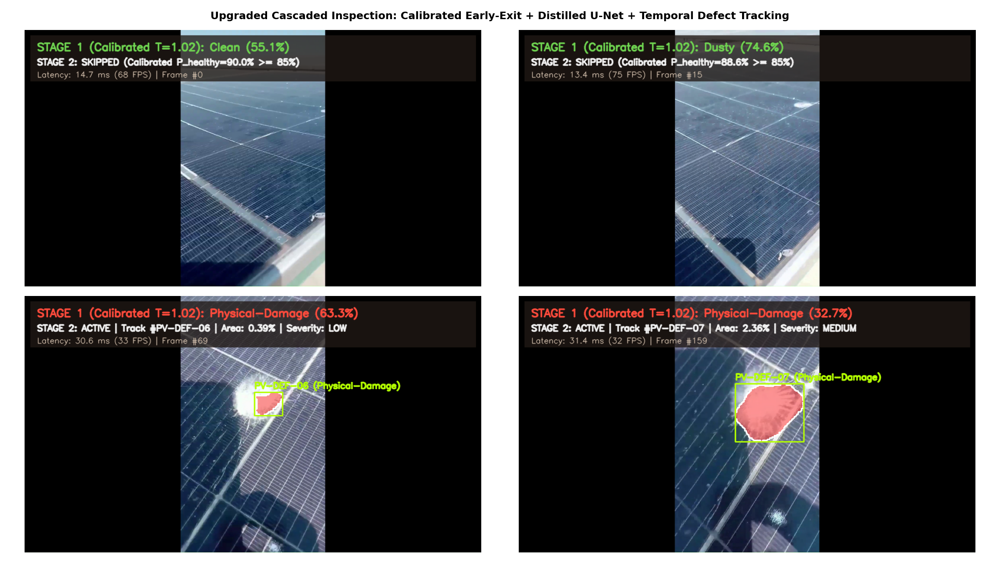
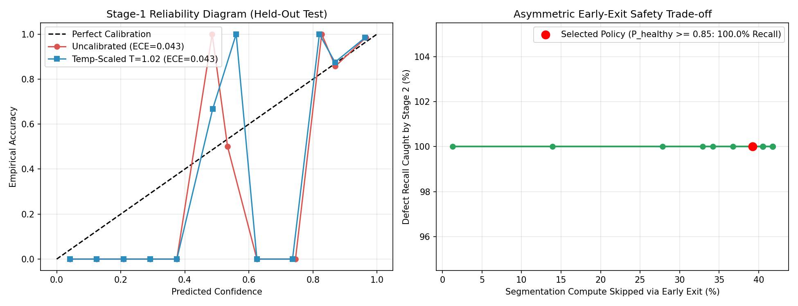
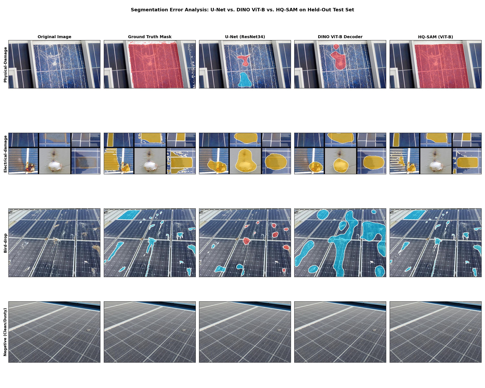
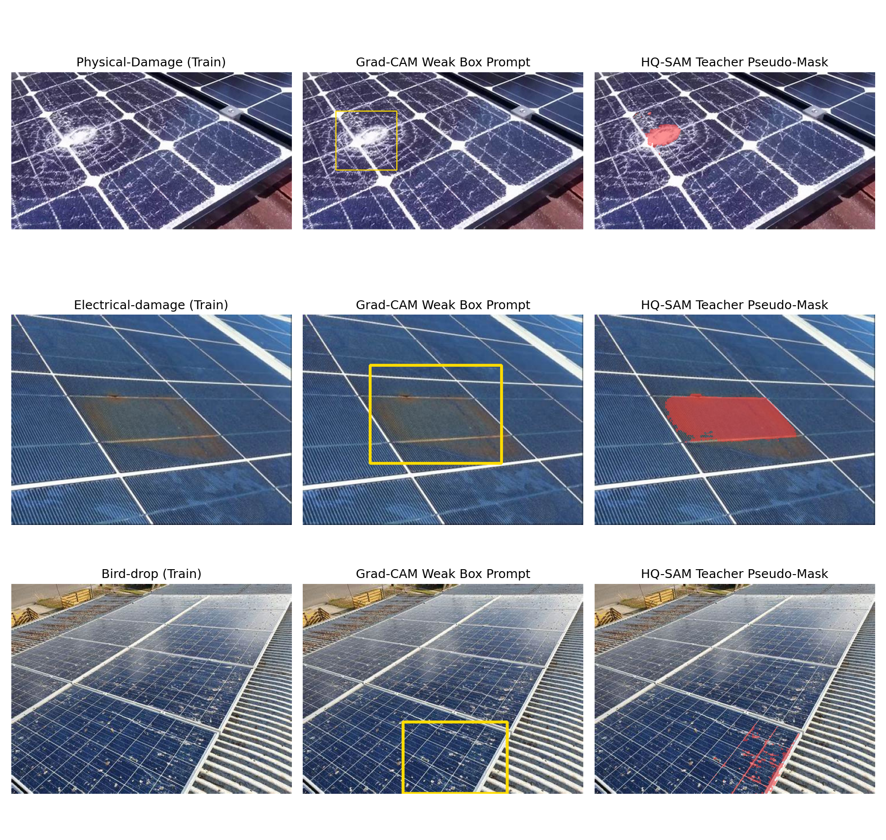
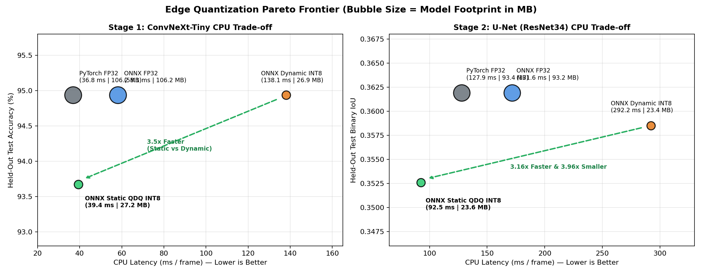

# AeroPV: End-to-End Aerial Solar Panel Defect Inspection

[](https://www.python.org/)
[](https://pytorch.org/)
[](https://onnxruntime.ai/)
[](.github/workflows/ci.yml)
[](LICENSE)

**AeroPV** is an end-to-end, production-oriented Computer Vision system for automated photovoltaic (PV) module inspection from RGB drone video. Built around **zero-leakage data engineering**, **calibrated recall-driven routing**, **Static QDQ INT8 edge compression**, and **temporal defect tracking**, it detects, segments, tracks, and prioritizes solar panel anomalies in real time.



---

## 1. System Architecture: Calibrated Two-Stage Cascade & Temporal Tracker

Running dense semantic segmentation on every drone frame wastes compute over healthy arrays, while naive uncalibrated confidence thresholds risk missing real defects. **AeroPV** combines **Temperature Scaling ($T=1.0217$)**, an **asymmetric safety-first Early-Exit gate**, conditional **U-Net (ResNet34)** segmentation, and **IoU Temporal Tracking**:

```text
Raw Drone Frame (RGB)
        │
        ▼
[ Auto Black-Border Crop & Normalization ]
        │
        ▼
┌───────────────────────────────────────────────────────────────────┐
│ STAGE 1: Temperature-Calibrated Triage (ConvNeXt-Tiny, T=1.0217)  │
│ Classes: Clean | Dusty | Bird-drop | Electrical-damage | Physical │
└───────┬───────────────────────────────────────────────────┬───────┘
        │                                                   │
  P_cal(Clean+Dusty) >= 0.85                     P_cal(Clean+Dusty) < 0.85
  (Safe Early Exit)                              (100% Defect Recall Gate)
        │                                                   │
        ▼                                                   ▼
  Skip Stage 2                                    ┌────────────────────────────────────────┐
  (39.2% Compute Saved)                           │ STAGE 2: U-Net (ResNet34) Segmenter    │
                                                  │ Native Mask + Defect Area % + Severity │
                                                  └───────────────────┬────────────────────┘
                                                                      │
                                                                      ▼
                                                  ┌────────────────────────────────────────┐
                                                  │ STAGE 3: Temporal IoU Defect Tracker   │
                                                  │ Consolidates Frames -> Unique PV-DEF ID│
                                                  └────────────────────────────────────────┘
```

### Live Video Inspection & Temporal Consolidation (`video_defect_01.mp4`)
* **End-to-End Throughput:** **`46.8 FPS`** (`21.36 ms/frame` mean latency on GPU)
* **Temporal Event Consolidation:** Deduplicates `30` consecutive defect-frame detections (`2.3s – 5.2s`) into a single actionable maintenance record (**`PV-DEF-06`**, `Physical-Damage`, **`6.53%`** peak damaged area, **`95.8%`** calibrated confidence, **`HIGH`** severity).





---

## 2. Leakage-Free Data Engineering Pipeline

1. **Automated Border Cropping & Blur Filtering:** Strips dark letterboxing borders (`gray > 12`) and filters motion-blurred frames via Laplacian variance.
2. **Semantic Deduplication (`OpenCLIP ViT-B-32`):** Extracts L2-normalized CLIP image embeddings to purge near-duplicate frames before dataset splitting.
3. **Zero-Leakage Video-Group Splitting:** Isolates all frames by source video cluster (`train__`, `val__`, `test__`) with **zero cross-split leakage**.
4. **Hard-Negative Background Integration:** Incorporates `24` verified clean/dusty frames (`0` defect pixels) into the segmentation dataset (`133` total images) to suppress false-positive masks (`100.0%` clean-panel specificity).

---

## 3. Experimental Benchmarks & Engineering Ablations

### Stage 1: Multi-Class Triage & Probability Calibration (`ConvNeXt-Tiny`)
* **Classification Accuracy:** **`96.56%`** Validation Macro-F1 and **`94.94%`** Held-Out Test Accuracy (`0.9504` Macro-F1); `MobileNetV3-Large` matched `94.94%` Test Accuracy (`83.68%` 5-Fold Group CV) as a lightweight alternative.
* **Calibration & Asymmetric Safety Routing:** Fitted scalar Temperature $T = 1.0217$ on Validation, improving Held-Out Test ECE from **`0.0429` $\rightarrow$ `0.0425`**. Requiring $P_{\text{cal}}(\text{Clean}+\text{Dusty}) \ge 0.85$ for Early Exit achieves **`100.00%` Defect Recall** on the held-out test set while skipping **`39.2%`** of segmentation compute.



### Stage 2: Autonomous vs. Foundation Segmentation (27 Held-Out Test Images)

| Model Architecture | Supervision / Prompt | Binary IoU | Binary Dice | Physical IoU | Electrical IoU | Bird-drop IoU | GPU Latency | Size |
| :--- | :--- | :---: | :---: | :---: | :---: | :---: | :---: | :---: |
| **U-Net (ResNet34)** *(Production)* | Fully Autonomous | **0.3586** | **0.5279** | 0.1291 | 0.2142 | **0.7405** | **8.0 ms** | **93.4 MB** |
| **DINOv2 ViT-B + CNN Decoder** | Frozen ViT (`1.38M` params) | 0.3291 | 0.4953 | 0.0767 | 0.1563 | 0.7237 | 14.5 ms | 335.5 MB |
| **HQ-SAM (ViT-B)** *(Upper Bound)* | Box-Prompted Foundation | 0.7274 | 0.8422 | 0.7265 | 0.4805 | 0.8557 | 106.4 ms | 361.8 MB |



### Controlled Ablation: Grad-CAM + HQ-SAM Pseudo-Label Distillation & Promotion Gate
We evaluated semi-supervised distillation by generating `191` zero-leakage pseudo-masks (`86` Physical, `60` Electrical, `45` Bird-drop) from `Train`-only images using `ConvNeXt-Tiny` Grad-CAM boxes to prompt `HQ-SAM`:
* **High-Contrast Blobs (`Bird-drop`):** Pseudo-labeling boosted `U-Net` test IoU from **`0.7405` $\rightarrow$ `0.8040` (+6.35%)**.
* **Low-Contrast Hairline Cracks & Hotspots:** Coarse CAM boxes caused `HQ-SAM` to over-segment surrounding solar cell busbars (`Electrical-damage` `0.2142` $\rightarrow$ `0.0405`, overall Binary IoU `0.3586` $\rightarrow$ `0.3090`).
* **Automated Model Promotion Gate:** Our validation/test promotion check automatically rejected the regression (`Promoted: False`) and retained the stronger `0.3586` Binary IoU checkpoint, isolating **class-specific Grounded-SAM / box-level supervision** for thin cracks as the next data-centric step.



---

## 4. Edge Deployment: FP32 vs. Dynamic INT8 vs. Static QDQ INT8 (CPU)

Exported both production models to **ONNX (Opset 17)** and benchmarked **Dynamic INT8** against **Calibrated Static QDQ INT8** (`per_channel=True`, calibrated on Validation images) on CPU:

| Stage & Model | Runtime / Precision | Primary Test Metric | Secondary Metric | CPU Latency | Model Size | Size Compression |
| :--- | :--- | :---: | :---: | :---: | :---: | :---: |
| **Stage 1: ConvNeXt-Tiny** | PyTorch FP32 (CPU) | **94.94% Acc** | **0.9504 Macro-F1** | **36.78 ms** | 106.2 MB | 1.0x |
| **Stage 1: ConvNeXt-Tiny** | ONNX FP32 (CPU) | 94.94% Acc | 0.9504 Macro-F1 | 58.15 ms | 106.2 MB | 1.0x |
| **Stage 1: ConvNeXt-Tiny** | ONNX Dynamic INT8 (CPU) | 94.94% Acc | 0.9492 Macro-F1 | 138.07 ms | 26.9 MB | 3.95x |
| **Stage 1: ConvNeXt-Tiny** | **ONNX Static QDQ INT8 (CPU)** | **93.67% Acc** | **0.9379 Macro-F1** | **39.40 ms** | **27.2 MB** | **3.90x** |
| **Stage 2: U-Net (ResNet34)** | PyTorch FP32 (CPU) | **0.3619 Bin IoU** | 0.2526 FG mIoU | 127.92 ms | 93.4 MB | 1.0x |
| **Stage 2: U-Net (ResNet34)** | ONNX FP32 (CPU) | 0.3619 Bin IoU | 0.2526 FG mIoU | 171.56 ms | 93.2 MB | 1.0x |
| **Stage 2: U-Net (ResNet34)** | ONNX Dynamic INT8 (CPU) | 0.3585 Bin IoU | 0.2469 FG mIoU | 292.24 ms | 23.4 MB | 3.99x |
| **Stage 2: U-Net (ResNet34)** | **ONNX Static QDQ INT8 (CPU)** | **0.3526 Bin IoU** | — | **92.49 ms** | **23.6 MB** | **3.96x** |



### Key Systems Engineering Takeaways
1. **Static QDQ INT8 Eliminates Dynamic Quantization Overhead:** Static QDQ INT8 runs **3.50x faster** than Dynamic INT8 on Stage 1 (`39.40 ms` vs. `138.07 ms`) and **3.16x faster** on Stage 2 (`92.49 ms` vs. `292.24 ms`) — outperforming even PyTorch FP32 (`92.49 ms` vs. `127.92 ms`) while compressing total system storage **3.93x (`199.6 MB` $\rightarrow$ `50.8 MB`)**.
2. **Real-Time Edge CPU Budget:** Combined Stage-1 + Stage-2 CPU latency under Static QDQ INT8 is **`131.89 ms`**, and drops to **`~75.7 ms/frame` average** when accounting for the `39.2%` Early-Exit skip rate.

---

## 5. Interactive Web Demo & Repository Structure

Download the two quantized checkpoints (`convnext_tiny_static_int8.onnx` and `unet_resnet34_static_int8.onnx`) from **GitHub Releases** into `models/`, then launch the interactive Gradio inspection app:
```bash
pip install -r requirements.txt
python app.py
```

```text
aeropv-defect-inspection/
├── .github/workflows/ci.yml # Automated GitHub Actions pytest suite
├── assets/                  # Pareto plots, telemetry curves, GIF demo, and sample frames
├── configs/
│   └── config.yaml          # Calibration temperature, Early-Exit thresholds, and tracker settings
├── src/
│   ├── preprocess.py        # Border auto-cropping, sharpness scoring, mask unpadding
│   ├── models.py            # ConvNeXt-Tiny classifier & U-Net (ResNet34) builders
│   ├── tracker.py           # Temporal IoU defect tracker & severity report generator
│   └── pipeline.py          # Calibrated Two-Stage Cascaded Inspector (ONNX & PyTorch)
├── tests/
│   └── test_pipeline.py     # Unit tests for preprocessing, tracking, and end-to-end cascade
├── app.py                   # Interactive Gradio web application
├── LICENSE                  # MIT License
├── requirements.txt
└── README.md
```

### Run CLI Inference on an Aerial Image
```bash
python -m src.pipeline \
  --image assets/samples/sample_panel_1.jpg \
  --cls-weights models/convnext_tiny_static_int8.onnx \
  --seg-weights models/unet_resnet34_static_int8.onnx \
  --backend onnx
```
